# Football Player Market Value Prediction

# 1. Executive Summary

This project develops a machine-learning system to estimate professional football players’ end-of-season market values. It uses a Transfermarkt-derived dataset covering player valuations, appearances, transfers, clubs, and competitions. The modeling population focuses on player-season observations from 2020/21 to 2025/26 in Europe’s five major domestic leagues: the Premier League, LaLiga, Serie A, Bundesliga, and Ligue 1. Features include player age and position, season performance, club results, transfer history and, when available, a previous market valuation.

Two XGBoost regression pipelines were trained to predict log-transformed market value: one uses the previous valuation and one acts as a fallback when that information is unavailable. A temporal evaluation trained on seasons 2020/21–2024/25 and held out 2025/26. On the held-out season, the history-based model achieved a mean absolute error (MAE) of €1.46 million and an R² of 0.970; the no-history model achieved an MAE of €4.75 million and an R² of 0.740. The gap shows that prior valuation is highly informative, while the fallback provides a less precise estimate for players without valuation history. These predictions estimate Transfermarkt market values; they are not forecasts of actual transfer fees.

The production models are refitted using labeled data through 2025/26 and power TransferLens, a Streamlit application for player discovery and analysis. The app presents 2026/27 end-of-season value projections alongside player profiles, scenario testing, model-driver explanations, similar-player suggestions, and player comparisons. Its estimates are intended as decision-support benchmarks, not definitive valuations.

---

# 2. Problem Definition

## 2.1 Background and Motivation

Estimating a football player's market value can provide a consistent benchmark for comparing players, monitoring changes in a squad's estimated asset value, and identifying cases that merit further scouting or recruitment analysis. Clubs and recruitment teams could use such estimates to support shortlisting and squad planning; analysts, researchers, and supporters could use them to explore how player characteristics and performance relate to valuation. A model should inform these decisions rather than replace specialist judgement or scouting.

Player valuation is an interesting machine learning problem because it reflects many interacting factors: age, position, playing time, performance, competition, club context, transfer history, and prior valuations. Their relationships may be nonlinear and can change over time. The target is also highly unevenly distributed, with a small number of exceptionally valuable players and many lower-valued players. In addition, the available target is an estimate rather than a directly observed transaction price, so the model learns patterns in published valuations and inherits their uncertainty and limitations.

In this project, “market value” refers to the value published by Transfermarkt, not the fee a club actually pays to sign a player. Transfermarkt describes its figures as expected values informed by pricing models and community discussion, and explicitly distinguishes them from transfer fees (Transfermarkt, n.d.). A transfer fee is the negotiated price in a particular transaction and may differ because of circumstances such as contract terms, release clauses, negotiation leverage, timing, or competition among buying clubs. The model therefore estimates a reference market value; it does not predict a guaranteed sale price.

## 2.2 Project Objective

The objective of this project is to build a supervised machine learning model that estimates a football player’s market value at the end of a season. The model uses player, club, and performance information from that season, with features intended to precede the end-of-season valuation. For example, information from the 2023/24 season is used to estimate the player’s value in the May–June 2024 valuation window. A small exception in the timing of club-level features is documented in Section 13.

## 2.3 Intended Use Case

The model is intended to support player analysis by providing an estimated end-of-season market value that can be used as a benchmark alongside a player’s profile, performance, and valuation history. Scouts and recruitment analysts could use it to compare players with similar positions or profiles, identify cases where a model estimate differs substantially from the published Transfermarkt value, and decide which players warrant closer review. Such differences should be treated as prompts for investigation, not proof that a player is undervalued or overvalued.

In the TransferLens application, users can explore player profiles, compare players, review factors contributing to an estimate, and test how changes to projected performance affect the result. Analysts can also compare model estimates with observed Transfermarkt valuations to assess model performance. 

The model is a decision-support tool: it estimates Transfermarkt market values, not actual transfer fees, and should not replace scouting expertise or independent due diligence.

## 2.4 Scope

The historical modeling dataset covers six seasons, from 2020/21 through 2025/26, and is restricted to the men’s top domestic divisions of England’s Premier League, Spain’s LaLiga, Italy’s Serie A, Germany’s Bundesliga, and France’s Ligue 1. 

The population consists of player-season observations from those competitions for which the required performance and valuation data are available; it is not a complete census of all professional or registered players. The evaluation holds out 2025/26, while 2020/21–2024/25 are used for model development. 

The application then produces projections for 2026/27, but that season is not part of the historical evaluation.

Historical data comes from the Transfermarkt-derived public dataset published on Kaggle and maintained in the transfermarkt-datasets repository (davidcariboo, 2026; dcaribou, 2026). It includes player profiles, appearances, club and match information, transfers, and historical player valuations.

The application’s 2026/27 projections use a separate current-season inference dataset collected from FBref (FBref, n.d.) using the SoccerData library (SoccerData developers, n.d.).

Other leagues and competitions, transfer-fee prediction, and factors not available in the project data are outside the scope of this analysis.

## 2.5 Project Limitations

Several limitations were identified before modeling. The target values are Transfermarkt estimates, not observed transfer prices, so they reflect a published valuation rather than a verified transaction outcome. 

Some player attributes are current snapshots and may not accurately represent a player’s characteristics or circumstances at an earlier valuation date.

The initial feature set also omits factors that can materially affect a player’s value, including injury history, expected goals and assists, contract duration, wages, and reputation. The analysis is limited to the selected seasons and five domestic leagues, so its results may not generalize to other competitions or future market conditions. 

Predictions should therefore be interpreted as estimates based on the available data, not definitive valuations or transfer-price forecasts.

---

# 3. Data Description

## 3.1 Data Source

The primary dataset used in this project is Football Data from Transfermarkt, published by davidcariboo on Kaggle and maintained through the open-source `transfermarkt-datasets` GitHub repository (davidcariboo, 2026; dcaribou, 2026).

The dataset contains structured football data collected from Transfermarkt and processed into an analysis-ready format. The GitHub repository documents the data-processing pipeline and schema used to produce the published datasets.

The database comprises 12 related tables covering competitions, games, clubs, players, appearances, player valuations, club games, game events, game lineups, transfers, countries, and national teams. Identifiers in these tables support joins across the relational structure.

The repository also provides a DuckDB snapshot. This was not accessible when the project began, so a local DuckDB database was created from the CSV files downloaded from Kaggle. The local database was used as a data source for the initial SQL exploratory data analysis (EDA).

As of October 2026, the repository states that updates are paused and the dataset is current through 6 July 2026. The latest date varies by table: game data extends to 6 July 2026, appearance data to 28 June 2026, and player valuation data to 12 June 2026. The repository also notes that 2026/27 squads are not covered (dcaribou, 2026). This cut-off informs the historical modeling scope; the application’s 2026/27 inference data is maintained separately.

Current-season inference data was collected from FBref (FBref, n.d.) using the SoccerData library (SoccerData developers, n.d.).

## 3.2 Database Overview

The current database contains approximately 7.6 million records distributed across 12 tables.

| Table | Approx. Rows | Description |
|---|---:|---|
| `players` | 50,149 | Player-level information |
| `clubs` | 796 | Club information |
| `competitions` | 65 | Competition metadata |
| `games` | 88,958 | Match-level information |
| `club_games` | 177,916 | Club-level match results |
| `appearances` | 1,894,350 | Player match appearances |
| `game_lineups` | 3,179,016 | Match lineup information |
| `game_events` | 1,274,469 | Match events |
| `transfers` | 175,165 | Player transfer history |
| `player_valuations` | 656,301 | Historical market valuations |
| `countries` | 124 | Country metadata |
| `national_teams` | 124 | National team information |

The structure is primarily event-oriented. Tables such as appearances, transfers, player_valuations, game_lineups and game_events contain historical observations associated with players, while players, clubs, competitions and countries act mainly as descriptive dimension tables.

For the machine learning stage, the raw relational structure was later transformed into an analytical dataset in which historical observations are aggregated to a consistent player level.

## 3.3 Entity Relationship

### 3.3.1 Entity Relationship Overview

#### Players

The players table contains one record per player and uses:
`player_id`
as its candidate primary key.

The table contains relatively stable characteristics such as date of birth, position, preferred foot and height, but also current-state attributes such as current club and current market value.

#### Appearances
The appearances table records individual player participation in matches.

Candidate primary key:
`appearance_id`

Main logical foreign-key relationships include:
- player_id → players.player_id
- game_id → games.game_id
- player_club_id → clubs.club_id
- competition_id → competitions.competition_id

This table is the main source of historical player-performance features.

#### Games
The games table contains one row per match.

Candidate primary key:
`game_id`

Main relationships include:
- home_club_id → clubs.club_id
- away_club_id → clubs.club_id
- competition_id → competitions.competition_id

#### Club Games
The club_games table represents each participating club within a match.

Its candidate composite key is:
`(game_id, club_id)`

Main relationships include:
- game_id → games.game_id
- club_id → clubs.club_id
- opponent_id → clubs.club_id

This structure is particularly useful for generating team-context features such as win rate, goals scored, goals conceded and league position.

#### Player Valuations
The player_valuations table contains historical Transfermarkt market values.

Its candidate composite key is:
`(player_id, date)`

Main relationships include:
- player_id → players.player_id
- current_club_id → clubs.club_id

This table provides the historical target variable for the machine learning problem.

#### Transfers
The transfers table contains historical player movements between clubs.

A candidate natural key is:
`(player_id, transfer_date, from_club_id, to_club_id)`

Main relationships include:
- player_id → players.player_id
- from_club_id → clubs.club_id
- to_club_id → clubs.club_id

The suitability of the composite natural key as a strict primary key depends on the presence of missing club identifiers and will therefore be treated cautiously.

### Entity Relationship Diagram

As mentioned, the source database contains 12 related tables. For the purpose of the machine learning pipeline, the analysis focuses primarily on the subset of entities shown in Figure 1 below:

*Figure 1. Simplified entity relationship diagram showing the principal
tables used to construct the machine learning dataset.*

The diagram represents the logical relationships used during analysis.

Several relationships involving the `clubs` table do not satisfy complete referential integrity because the source data contains historical, academy, reserve, national-team, and lower-league entities that are not represented in the `clubs` dimension.

`A full-source database ERD is available in Appendix B`

## 3.4. Data Dictionary
A complete data dictionary was created to document the structure and intended analytical use of the source data. For each field, the dictionary records its data type, logical key role, interpretation, and potential relevance to the machine learning pipeline.

As the DuckDB provided by source was unreachable, primary-key and foreign-key labels in the dictionary therefore represent candidate or logical relationships identified during schema analysis rather than necessarily enforced database constraints.

The complete data dictionary is provided in Appendix A.

---

# 4. Data Understanding and Quality Assessment

`For this section refer also to 01_schema_validation.sql`

## 4.1 Primary Key Validation

Candidate primary keys were identified from the database structure and tested for uniqueness.

The principal candidate keys investigated were:
- players.player_id
- clubs.club_id
- games.game_id
- appearances.appearance_id
- game_lineups.game_lineups_id
- (player_id, date) for player_valuations
- (game_id, club_id) for club_games
- (player_id, transfer_date, from_club_id, to_club_id) for transfers

The purpose of these tests was not only to understand the relational structure of the source database, but also to identify the appropriate grain of each table before feature engineering.

Composite keys were necessary for tables where a single identifier does not uniquely describe an observation. For example, a game appears twice in club_games, once for each participating club. Therefore, game_id alone cannot uniquely identify a club_games record, whereas the combination (game_id, club_id) represents the natural observation grain.

The transfer table, for example, presents a more complex case. A player may perform multiple transfers and, in some cases, multiple transactions may share the same transfer date (even though is not common, some examples where found). The combination of player, date, origin club and destination club was therefore investigated as a candidate natural key.

## 4.2 Referential Integrity

Referential integrity checks were performed on the main relationships between players, games, clubs, competitions, transfers, and valuations.

Most of the core relationships were consistent. All transfer and valuation records matched valid players, while only one player ID in appearances was not found in the players table. Relationships to games were also complete for appearances, game_lineups, and club_games.

Most inconsistencies were related to club IDs. Several tables reference clubs that are not present in the clubs table. Manual inspection showed that many of these correspond to academy teams, reserve teams, national teams, or smaller clubs.

A similar situation was found in game_lineups, where many player IDs are not present in the players table. Manual checks indicated that many of these are retired or historical players.

These unmatched records were therefore not treated automatically as invalid data. Instead, the affected relationships are considered logical relationships with incomplete historical coverage.

## 4.3 Temporal Coverage
 `For this section reference to 02_temporal_coverage.sql`

The source tables cover different historical periods. Match data ranges from June 2006 to July 2026, player appearances from July 2012 to June 2026, and historical player valuations from January 2000 to June 2026. Transfer records extend further back and also contain a small number of future-dated transfers corresponding to scheduled player movements.

For the modeling dataset, the project focuses on the six seasons from 2020/21 to 2025/26 and on the five major European domestic leagues: the Premier League (England), LaLiga (Spain), Serie A (Italy), Bundesliga (Germany), and Ligue 1 (France).

| Season | League Matches | Player Appearance Records |
|---|---:|---:|
| 2020/21 | 1,826 | 53,826 |
| 2021/22 | 1,826 | 53,754 |
| 2022/23 | 1,826 | 56,009 |
| 2023/24 | 1,752 | 54,097 |
| 2024/25 | 1,752 | 54,295 |
| 2025/26 | 1,752 | 54,302 |

Match coverage across these competitions is complete and consistent throughout the selected period. The Premier League, LaLiga, and Serie A contain 380 matches per season, while the Bundesliga contains 306. Ligue 1 contains 380 matches until the 2022/23 season and 306 from 2023/24 onward, following the reduction of the league from 20 to 18 clubs.

Player appearance coverage is also stable across the selected period, with approximately 54,000–56,000 appearance records per season across the five leagues.

Domestic cup and European competition matches are not included in the initial performance dataset. This keeps the baseline population comparable across leagues and seasons. These competitions may later be added as separate feature groups rather than combined with domestic league statistics.

Overall, the 2020/21–2025/26 period provides a consistent and sufficiently dense historical population for building and evaluating the initial machine learning model.

## 4.4 Missing Values

`For this section refer to 03_missing_values.sql`

Missing-value analysis was performed on variables considered relevant to the initial modeling pipeline, with particular attention given to the selected 2020/21–2025/26 top-five-league population.

First thing to note, is that the core performance data is highly complete. Across 326,283 player appearance records within the model scope, no missing values were found for player identifiers, game identifiers, club identifiers, competition identifiers, minutes played, goals, assists, yellow cards, or red cards. Club-game information is similarly complete for the selected population, including goals, league positions, and match outcomes.

Player characteristics also show strong coverage. Among the 6,157 players included in the modeling population, position is complete. Only 2 players are missing date of birth, 1 is missing sub-position, 107 (1.74%) are missing preferred foot, and 91 (1.48%) are missing height.

Historical valuation data is complete for the required fields when valuation records are available. In the initial player population, 196 players (3.18%) have no valuation history. After target selection, 82 player-season observations lack a previous valuation; the model without history provides a route for these cases.

Transfer information is substantially less complete. Approximately 20% of players have no transfer history, while transfer fees and transfer-time market values are missing from roughly one-third of existing transfer records. The trained models use transfer counts and timing indicators, but not transfer fees.

No missing values were imputed or removed during this initial data review. Model preprocessing later imputed missing numerical and categorical features within each training fold.

## 4.5 Sanity and Consistency Checks

`For this section refer to 04_sanity_checks.sql`

Sanity checks were performed on player attributes, appearances, games, club-level match records, historical valuations, and transfers within the selected modeling population.

No material inconsistencies were identified in the core performance data. Player ages and heights fall within plausible ranges, while appearance statistics contain no negative values or invalid playing-time records. Appearance dates and competition identifiers are fully consistent with the corresponding games, and each player's club matches one of the two clubs participating in the match.

Game and club-game records also show strong internal consistency. No matches contain identical home and away clubs, negative goal values, invalid league positions, or inconsistencies between match scores and recorded win indicators.

Historical market values range from €10,000 to €200 million, with no zero or negative values. Inspection of the highest-valued players did not identify implausible records.

Transfer data contains no negative fees or market values. A small number of records correspond to scheduled future transfers; transfer features count only events dated before the target valuation.

Overall, the selected data shows strong internal consistency and no sanity issues requiring remarkable modifications in the data.

---

# 5. Modeling Problem Definition
This project uses regression to estimate a professional football player's end-of-season market value from available player, performance, and club information.

The model learns from historical player-season records, linking player characteristics, season performance, and club context to the corresponding end-of-season market valuation. Season (t) inputs are used to estimate the end-of-season value for season (t).

The trained models are applied to 2026/27 player data to produce projected end-of-season values. These projections are outside the historical evaluation window and remain subject to changes in player performance and market conditions.

The application also explains which available inputs are associated with each estimate, such as age, playing time, performance, position, league, and club context. These explanations describe model behavior, not causal effects.

Historical Transfermarkt market values provide the target labels used for training.

## 5.1 Unit of Observation

Each observation in the modeling dataset represents one player in one season. A player can therefore appear in several rows across different seasons.

The input features describe the player's profile, club context, and performance in that season. The target is the market value recorded in the corresponding May–June end-of-season valuation window.

This player-season structure provides repeated historical examples of how performance and context relate to market value at the end of each season.

## 5.2 Target Variable

The target variable is the player's end-of-season market value in euros.

Market value data comes from the `player_valuations` table, which contains historical valuation records for the modeling population.

As shown in the Market Value Revisions section in 02_temporal_coverage.sql, the largest concentration of valuation updates occurs around the end of the season, particularly in June, with another important revision period around December. Smaller updates also take place throughout the season.

The target uses the latest recorded valuation in each season's May–June window. This aligns the valuation with season-level performance data such as appearances, minutes, goals, and assists.

The window includes May as well as June because valuation dates vary between players and seasons.

## 5.3 Prediction Horizon

The model estimates a player's market value at the end of the same season used to calculate the performance features.

The end-of-season valuation cycle is used as the target. Historical valuations from earlier cycles may be used as inputs in the model that includes valuation history.

For example, a player's 2023/24 profile, club context, and performance are used to estimate their value in the May–June 2024 valuation window.

This setup allows the model to learn how a player's performance over the course of a season is associated with their market value update at the end of that season. The relevant performance period is therefore approximately one full season (normally from August to May), rather than a prediction horizon of twelve months.

The exact valuation date varies between players and seasons; the target is linked to the end-of-season valuation window rather than a fixed calendar date.

## 5.4 Prediction Cutoff

The prediction cutoff defines the latest point in time from which information can be used to generate the model features.

Each target valuation date acts as the intended cutoff for historical inputs. For previous market value, the dataset applies a stricter cutoff of 1 May in the target year to avoid selecting an update from the same end-of-season cycle.

For example, when estimating a player's market value in the June 2024 valuation cycle, the model can use information from the 2023/24 season that was available before that valuation, but it cannot use transfers, performances, injuries or other events occurring afterwards.

This cutoff is important to avoid data leakage and to ensure that the historical training setup reflects how the model would be used with new data in practice.

The dataset construction SQL records the exact target valuation date and applies it to transfer-history features. A final timing audit found that all player appearances used in the dataset preceded their target valuation, while some club aggregates included later matches, as described in Section 13.

## 5.5 Leakage Prevention

Temporal alignment was checked against target valuation dates, with particular attention to historical valuations and transfers.

Player appearance aggregates and transfer-history features were aligned before each target valuation. Club aggregates were computed over the full season and have a small number of post-valuation cases, discussed in Section 13.

Previous market value was restricted to valuations before 1 May of the target year, earlier than the target's May–June window.

The same feature-construction rules were applied to training, validation, and test seasons.

---

# 6. Feature Definition and Engineering

Model features were constructed from the relational tables to describe each player's profile, domestic-league performance, club context, and transfer history. The complete inputs used by the trained models are summarized in Appendix D.

## 6.1 Player Characteristics

The `players` table supplied position, sub-position, preferred foot, height, and date of birth. Age was calculated at the target valuation date. Player names, citizenship, and identifiers were not used as model features.

## 6.2 Performance Features

The `appearances` table supplied season totals for matches, minutes, goals, assists, yellow and red cards, and clean sheets. Derived inputs included goals, assists, goal contributions, and cards per 90 minutes, plus clean-sheet rate. Per-90 rates were only calculated for players with at least 900 minutes in a season; lower-minute observations retained missing rates for model preprocessing. Position and sub-position were included as categorical inputs, but separate models by playing role were not trained.

## 6.3 Club Performance Features

The `games` and `club_games` tables identified seasons and domestic competitions and supplied club-level context. The model used club matches played, goals scored and conceded, and average points per game. When a player represented more than one club in a season, the club where they played the most minutes was treated as their primary club. Full-season club aggregates were used; their small timing limitation is described in Section 13.

## 6.4 Historical Valuation Features

The `player_valuations` table supplied the end-of-season target and, for the history-based model, the log of the previous market value and days since that valuation. The previous valuation was selected from records before 1 May in the target year. Models with and without these historical-value features were compared separately because previous valuation is an especially strong predictor.

## 6.5 Transfer Features

The `transfers` table supplied the count of previous transfers, a previous-transfer indicator, days since the last transfer, and transfers during the season. Only transfers dated before the target valuation were counted. Transfer fees were not included in the trained feature set.

## 6.6 Game Lineups and Game Events

The `game_lineups` and `game_events` tables were reviewed as potential sources of additional match context, but they did not contribute features to the trained models.

## 6.7 Final Feature Strategy

The final feature strategy retained one common set of player, performance, club, and transfer inputs. Two model routes were fitted: a history-based route adding the two prior-valuation features and a fallback route without them. Feature selection and comparison were evaluated with chronological validation folds.

---
# 7. Modeling Dataset Construction

## 7.1. Dataset Grain

Each row in the dataset represents one player and one season. The same player can therefore appear multiple times across different seasons, depending on their participation in the leagues and seasons included in the modeling scope.

`One row = one player x one season`

## 7.2. Target Construction

It was decided to use the end-of-season market value as the target. Transfermarkt normally performs two major valuation updates during the season, as identified previously: one around December (mid-season) and another around May/June (end-of-season).

For this use case, the target is systematically selected from the May-June valuation window, taking the latest available valuation for each player during that period.

## 7.3. Player and Club Assignment

Since a player can have more than a team each season, it was decided to consider as primary club in features the club where the player accumulated the most minutes during that season.

## 7.4. Historical Features and Cutoffs

The player's previous market valuation is included as a historical feature.

To avoid using information from the same end-of-season valuation cycle as the target, May 1st of the target year is used as the cutoff. Only valuations recorded before this date can be considered as historical features.

## 7.5. Modeling Dataset Validation

After building the modeling dataset, some basic data validation was performed, this information is available in `06_modeling_dataset_validation`.

Here are the main findings:

The final V1 modeling dataset contains 15,357 player-season observations covering the 2020/21 to 2025/26 seasons.

The dataset preserves the intended grain of one observation per player and season, with no duplicated player-season combinations identified during validation.

Coverage of the main modeling variables is very high. There are no missing values for the target market value, primary club, competition or season performance variables. Missing values in player characteristics are limited to a small number of observations, including 3 missing ages, 1 missing sub-position, 61 missing preferred-foot values and 36 missing heights.

Historical market value information is available for 99.47% of the dataset, with only 82 player-season observations having no previous valuation before the defined cutoff. Transfer history is also widely available, although 1,452 observations have no recorded previous transfer. These cases are retained, since the absence of previous transfer information can itself be meaningful.

Most players remain with the same club throughout the season. Approximately 94.5% of player-season observations involve only one club, 5.5% involve two clubs and only two observations involve three clubs. This supports the decision to use the club where the player accumulated the most minutes as the primary club for the season.

The player participation rate averages approximately 57% of the primary club's matches. Four observations exceed 1. All four players represented two clubs in that season: the numerator counts appearances across both clubs, while the denominator counts matches for the primary club only. This derived rate was not used as a model feature.

Overall, the validation results indicate that the V1 modeling dataset is sufficiently complete and structurally consistent to proceed to exploratory analysis and model development.

# 8. Exploratory Data Analysis

## 8.1 Target Distribution

End-of-season market values are strongly right-skewed. Most observations are concentrated at lower values, while a small number of highly valued players create a long upper tail. The raw target has a skewness of approximately `3.65`.

Applying a `log(1 + market value)` transformation reduced skewness to approximately `−0.20` and produced a more balanced distribution. This supported using the transformed target during model training, with predictions converted back to euros for interpretation.

## 8.2 Player Characteristics

Market value varies with age in a non-linear pattern. Values generally rise from the late teenage years into the early and mid-20s, with the highest median values around ages 24–26, and then tend to decline. Results for the youngest and oldest age groups should be interpreted cautiously because they contain fewer observations; for example, the age-16 group contains only nine player-season observations.

Values also differ by playing position. Approximate median values are €5.5 million for midfielders, €5.0 million for attackers, €4.5 million for defenders, and €3.0 million for goalkeepers. 

Sub-position analysis shows further variation, although high values for less common roles—such as second strikers—are based on smaller samples. 

Preferred-foot groups have broadly similar median values, while height alone has almost no linear relationship with log market value (correlation approximately −0.02).

## 8.3 Performance and Playing Time

Playing time is positively associated with market value. Total games and total minutes have moderate correlations with log market value of approximately 0.55 and 0.53, respectively. They are also highly correlated with each other (approximately 0.90), so they contain overlapping information.

Total goals and assists show slightly stronger relationships with market value than their per-90 rates. For exploratory per-90 comparisons, applying a 900-minute minimum helped reduce unstable rates caused by very limited playing time. Attacking statistics are more strongly associated with value for attackers and midfielders than for defenders, and show little relationship for goalkeepers.

Among defensive measures, clean-sheet totals show the strongest relationship with market value, particularly for goalkeepers (approximately 0.64). Clean-sheet rates also show moderate associations after the minutes threshold. These measures may reflect team strength and playing time as well as individual contribution. Card-related features show weaker or less consistent relationships.

## 8.4 Club and Competition Effects

Club performance indicators are associated with player market value. Points per game, points, wins, and goals scored have correlations of approximately 0.44–0.45 with log market value. Losses and goals conceded are negatively associated with it, at approximately −0.40 and −0.32, respectively. Several club indicators are highly correlated with one another, for example, points, wins, and points per game have correlations around 0.98–0.99 so they represent overlapping information.

Market-value distributions also differ across competitions. Premier League players have notably higher median and upper-range values than players in the other four leagues.

## 8.5 Previous Valuation and Transfer History

Previous market value is the strongest individual feature examined. Its log-transformed value has a correlation of approximately 0.98 with the log-transformed target, indicating that valuations tend to persist between periods. Previous values are available for 15,275 of 15,357 observations; only 82 lack this information. The time since the previous valuation has a weaker negative correlation of approximately −0.21.

Transfer-history features show weaker associations. Having at least one previous transfer has a correlation of approximately 0.32 with the target. Transfer counts and time since the most recent transfer have relatively weak relationships. These patterns may reflect factors such as career stage and experience rather than a direct effect of transfers on value.

## 8.6 Seasonal Trends

Across the observed seasons, median market value rises from approximately €4 million in 2020/21 to €6 million in 2025/26. The mean rises from approximately €9 million to €13.5 million, while the upper range also broadens in later seasons. Because the mean is more affected by a small number of highly valued players, the median provides a useful complementary view.

The upward trend supports evaluating models with a chronological split, so performance is tested on a later season rather than relying only on a random split.

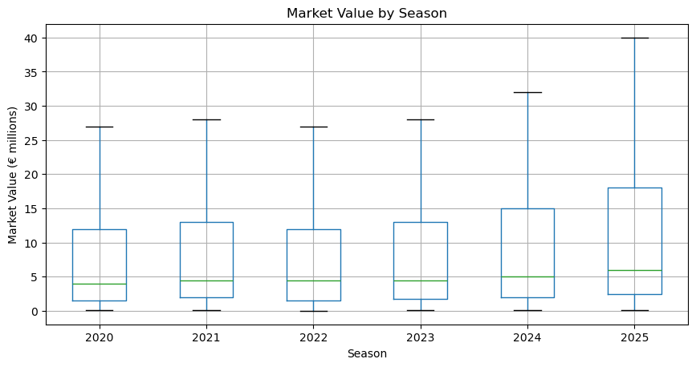

Overall, the EDA supported transforming the target, preserving the time order in evaluation, and accounting for differences by age, position, performance, and club context. The strong relationship with previous valuation also motivated evaluating separate model routes for players with and without that information.

---

# 9. Modeling Methodology

## 9.1 Baseline Model

A persistence baseline predicts that a player’s end-of-season market value will equal their most recent available market value:

`Predicted value = previous market value`

This baseline was evaluated only for observations with a previous valuation. Across the temporal validation folds, it achieved an average MAE of approximately €1.34 million, RMSE of €2.82 million, and R² of 0.97. It provides a useful reference for assessing whether models using performance and player characteristics add predictive information beyond the persistence of market values.

## 9.2 Candidate Models

Three regression algorithms were compared: **Ridge regression**, **Random Forest**, and **XGBoost**. 

Each was tested in two feature configurations: with previous market-value information and without it. This allowed the analysis to assess how much predictive information player characteristics, performance, and context provide when valuation history is unavailable.

Due to the different needs of the models, different preprocessing techniques were applied:

- Numerical features were imputed; categorical features were imputed and one-hot encoded. 
- Numerical features were standardized for Ridge regression but not for the tree-based models. 
- The target was transformed using log(1 + market value) during training, then converted back to euros for evaluation.

**XGBoost** (XGBoost developers, n.d.) performed best among the candidate algorithms and was selected for hyperparameter tuning. Grid search used the same temporal folds and evaluated 54 parameter combinations for each feature configuration. The selected model without historical valuation used 600 estimators, a maximum depth of 5, a learning rate of 0.05, and a subsample ratio of 0.8. The model with historical valuation used 300 estimators, a maximum depth of 5, a learning rate of 0.05, and a subsample ratio of 0.8.

In walk-forward validation, the untuned XGBoost model without historical valuation achieved an average MAE of approximately €4.29 million, compared with €4.59 million for Random Forest and €5.43 million for Ridge. The tuned XGBoost models achieved average validation MAEs of approximately €4.19 million without historical valuation and €1.24 million with it. The latter modestly improved on the persistence baseline, indicating that most of the with-history model’s predictive strength comes from the persistence of previous valuations.

## 9.3 Train / Validation / Test Strategy

A temporal split was used because the intended use is to estimate values for a season using information learned from earlier seasons. A random split could place observations from later seasons in the training set while testing on earlier seasons, which would not reflect this use case.

The development data covers 2020/21–2024/25. Four expanding-window folds validated on 2021/22, 2022/23, 2023/24, and 2024/25; each fold trained only on seasons preceding its validation season. The 2025/26 season was excluded from model selection and reserved as the final test set.

Data preparation used pandas, model pipelines and evaluation used scikit-learn, and the selected gradient-boosting model was implemented with XGBoost. SHAP was used for model explanations (pandas development team, n.d.; scikit-learn developers, n.d.; Chen & Guestrin, 2016; XGBoost developers, n.d.; Lundberg & Lee, 2017).

## 9.4 Evaluation Metrics

The main metrics used were:

- MAE
- RMSE
- R² 

These indicators were used to evaluate predictions after converting them back to euros. MAE reports the typical absolute prediction error in an interpretable currency unit. RMSE is also expressed in euros, but penalizes larger errors more heavily. R² provides a complementary measure of how much variation in the observed values the model explains.

---

# 10. Results

## 10.1 Baseline Performance

The persistence baseline assumes that a player’s future market value will be equal to their most recently observed value. It provides a demanding benchmark because market valuations tend to change gradually, and historical value is a strong predictor of future value.

Across the walk-forward validation folds, the baseline achieved a mean MAE of €1.34 million, an RMSE of €2.82 million, and an R² of 0.971. This baseline applies to players with a previous valuation available, so comparisons with models that do not use that information should be interpreted with that difference in mind.

## 10.2 Model Comparison

Candidate models were compared using temporal, walk-forward validation. The figures below are mean scores across the validation folds, with errors reported in millions of euros. Models were evaluated both without previous market value as an input and with it included.

| Model | Feature setup | MAE (€m) | RMSE (€m) | R² |
|---|---|---:|---:|---:|
| Persistence baseline | Previous value only | 1.34 | 2.82 | 0.971 |
| Ridge | Without previous value | 5.43 | 11.98 | 0.468 |
| Random Forest | Without previous value | 4.59 | 9.47 | 0.674 |
| XGBoost | Without previous value | 4.29 | 8.51 | 0.736 |
| Ridge | With previous value | 1.39 | 3.19 | 0.963 |
| Random Forest | With previous value | 1.33 | 2.90 | 0.969 |
| XGBoost | With previous value | **1.25** | **2.73** | **0.972** |

**XGBoost** performed best among the evaluated machine-learning models in both feature setups. Including the previous market value substantially improved performance. Without it, the models had considerably higher errors, indicating that current player and performance characteristics alone do not capture all the information reflected in recent valuations.

## 10.3 Final Model

**XGBoost** was selected as the final model because it achieved the strongest walk-forward validation results among the tested models. 

Two configurations were retained: one using previous market value as a feature and one without it.

The target was log-transformed during training and predictions were converted back to euros for evaluation. The tuned XGBoost configuration used 600 estimators for the model without previous value and 300 for the model with previous value; both used a maximum tree depth of 5, a learning rate of 0.05, and a subsample rate of 0.8.

Performance on the held-out 2025/26 test season was:

| Final model | MAE (€m) | RMSE (€m) | R² |
|---|---:|---:|---:|
| XGBoost without previous value | 4.75 | 9.66 | 0.740 |
| XGBoost with previous value | **1.46** | **3.30** | **0.970** |

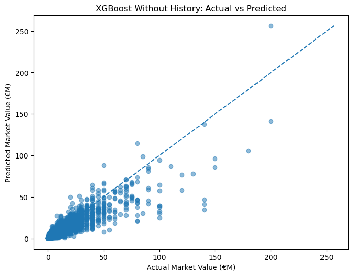

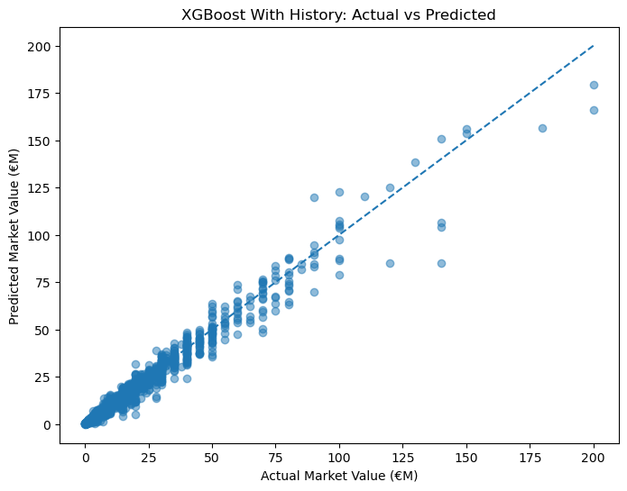

The model using previous value substantially outperformed the version without it on the held-out season. This is consistent with the validation results, but also shows that much of the model’s predictive strength comes from the continuity of market valuations over time.

## 10.4 Feature Importance and Interpretation

SHAP analysis (Lundberg & Lee, 2017; SHAP developers, n.d.) showed different patterns for the two XGBoost configurations.

**For the model without previous market value**, total minutes played and age were among the most influential features. Competition and club context, as well as player production measures such as goals and assists, also contributed to predictions.

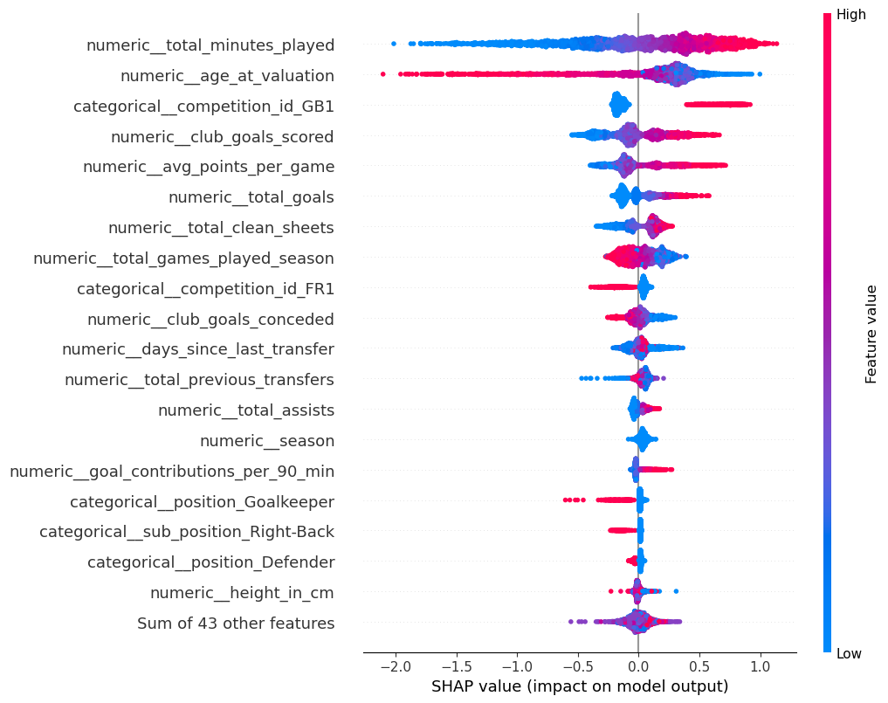

**For the model with previous market value**, historical value was the dominant feature. Age and minutes played were also influential, while goals, club context, and competition made smaller contributions. This model therefore behaves primarily like an updating model: it starts from the previous valuation and adjusts it based on other available information.

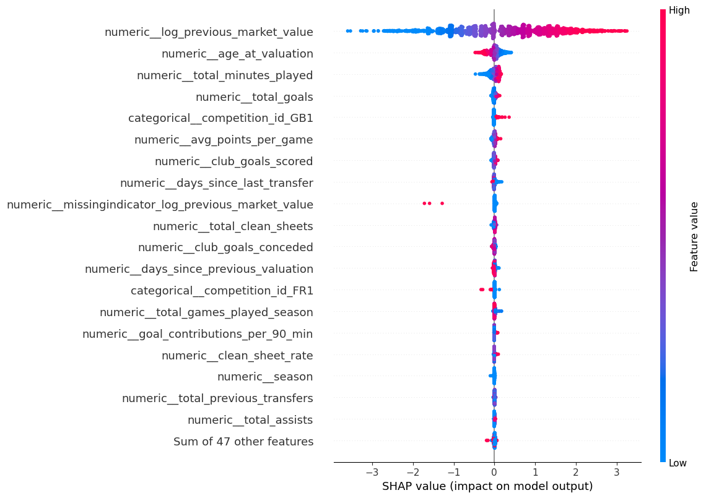

## 10.5 Error Analysis

Absolute error increased with the player’s actual value, particularly for the highest-value players. The table shows test-set MAE by actual market-value band.

| Actual value band | Players | MAE without previous value (€m) | MAE with previous value (€m) |
|---|---:|---:|---:|
| Below €2m | 468 | 0.60 | 0.14 |
| €2m–€5m | 569 | 1.30 | 0.42 |
| €5m–€10m | 433 | 2.60 | 0.88 |
| €10m–€25m | 559 | 5.57 | 1.79 |
| €25m–€50m | 303 | 9.70 | 2.96 |
| Above €50m | 127 | 27.53 | 8.03 |

The model without previous value tended to overpredict in the lower value bands and increasingly underpredict in the higher bands. The model with previous value had smaller average bias across the bands, but it also tended to underpredict the most valuable players. The largest individual errors occurred among high-value players whose test-season valuations differed substantially from what their other available features suggested.

---

# 11. Final Application / Product

The trained model is presented through an interactive Streamlit (Streamlit, Inc., n.d.) application for exploring player valuations. The application is intended as an analytical tool for benchmarking and comparison; its estimates should not be interpreted as official valuations or guaranteed transfer prices.

## 11.1. Player Discovery

The landing page provides a searchable player table, with filters for league, club, and position. It presents key player information and statistics to support browsing across the dataset. Selecting a player opens their individual profile.

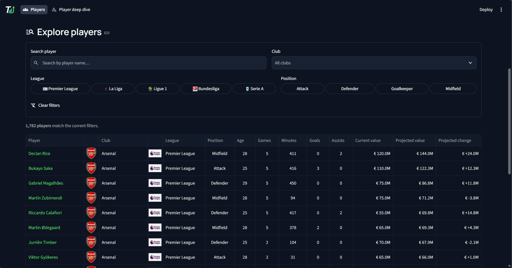

## 11.2. Player Profile and Valuation

Each player page brings together profile information, current-season statistics, and available valuation history. The page displays the model’s estimated market value for the end of the 2026/27 season based on current statistics. This value is presented alongside the latest recorded market value when one is available.

The estimate is generated using the model configuration appropriate to the player’s available inputs, including whether a previous market value is available.

Player photos and profile details provide context when the source data contains them. Club badges are sourced from the football-logos repository (luukhopman, n.d.); league badges are included with the application assets.

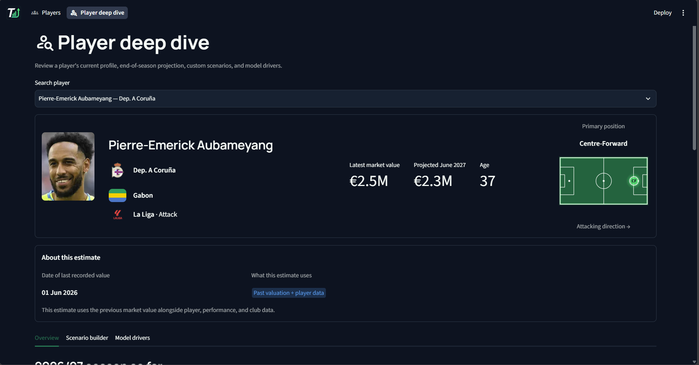

## 11.3. Prediction Context and Model Drivers

The application provides context for the estimate, including the information and model approach used to produce it. Explanations of the model’s main drivers with SHAP help users understand which available factors are associated with higher or lower predictions. These explanations describe model behaviour; they do not establish that a particular factor caused a player’s valuation.

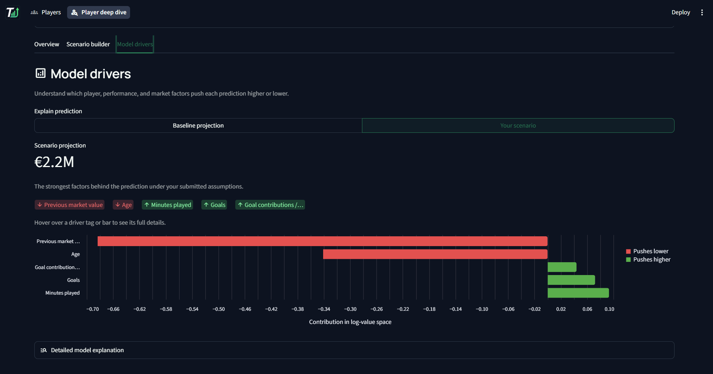

## 11.4. Scenario Builder

The baseline projection uses current-season performance and projected end-of-season inputs. Users can adjust selected inputs to explore how a hypothetical change affects the model’s estimate. The scenario view presents the resulting value alongside the baseline and summarizes the change in the context of the selected inputs. Scenarios are what-if analyses, not forecasts of what will necessarily happen.

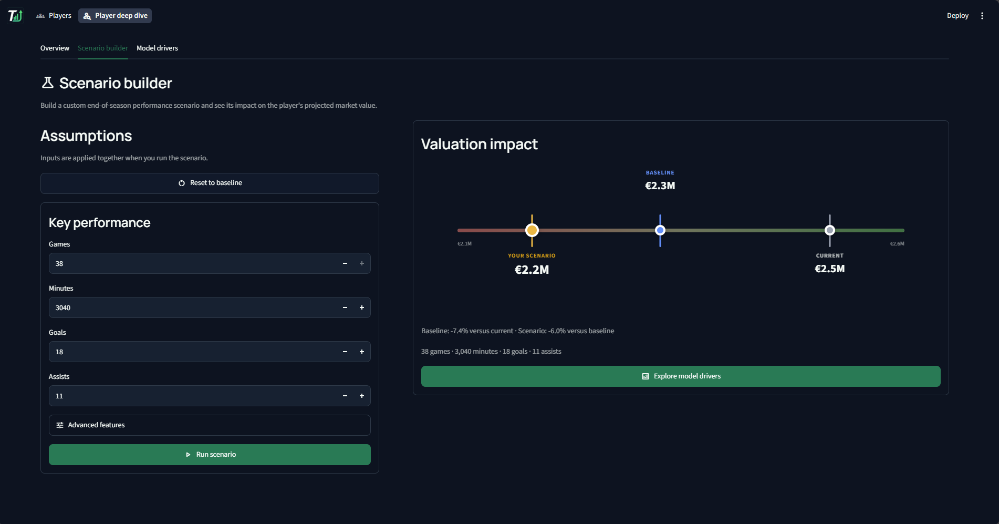

## 11.5. Player Comparison

The application allows users to compare two or three players across estimated value, available valuation, playing time, and relevant performance statistics. This supports side-by-side benchmarking while retaining each player’s profile context. 

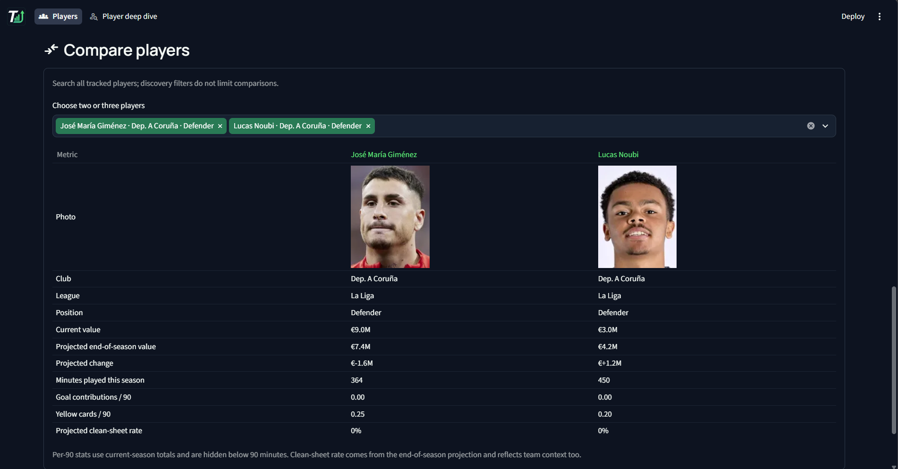

## 11.6. Intended Use and Limitations

The application is designed to support exploration, benchmarking, and scouting or recruitment analysis. It does not determine a player’s actual transfer fee, account for every factor involved in a transfer, or replace expert judgement. Results depend on the coverage and quality of the underlying data and the model’s limitations. The current application covers players in the five selected domestic leagues; players outside its current-season dataset will not appear.

---

# 12. Discussion

The results show a clear difference between predicting for a player with a previous market valuation and estimating value without one. In four walk-forward validation folds, the XGBoost model with previous market value achieved a mean MAE of approximately €1.25 million, compared with €1.34 million for the persistence baseline, which simply carries the previous value forward. Its mean RMSE was approximately €2.73 million, versus €2.82 million for the baseline. This is an improvement, but a modest one: much of the model’s predictive strength comes from the persistence of market valuations over time.

On the held-out 2025/26 season, the XGBoost model with previous value achieved an MAE of approximately €1.46 million, RMSE of €3.30 million, and R² of 0.970. The persistence baseline was evaluated in the validation folds, so a direct comparison on this held-out season is unavailable.

When previous market value was excluded, the XGBoost model’s mean validation MAE was approximately €4.29 million; on the 2025/26 holdout it was approximately €4.75 million. This version is less accurate, but it shows that player performance and context still contain useful valuation signals when no prior valuation is available.

The feature explanations are consistent with those results. Previous market value is the strongest driver when included. Without it, playing time and age are prominent, alongside performance and club or competition context. These explanations describe how the model uses the available inputs; they do not establish that a feature causes a player’s market value to change.

The model is less reliable for players at the high end of the value range, where errors tend to be larger and estimates can be conservative. Predictions should therefore be treated as benchmarks, not definitive valuations—especially for unusually valuable players, players with limited playing time, and players without an established valuation history.

---

# 13. Limitations

The target is Transfermarkt’s estimated market value, not an observed transfer fee. A transfer fee is a negotiated transaction that may be affected by contract length, financial pressure, release clauses, competition between clubs, and other circumstances. The model therefore estimates a recorded valuation, not what a player would necessarily cost in a particular transfer.

The modeling data is limited by its historical coverage and the completeness of its source records. Some player and club attributes are incomplete, and current-state profile information may not accurately represent what was known at each historical prediction date. This creates a risk of temporal inconsistency even when performance and valuation data are organized by season.

A timing audit found that no modeled player had an appearance after their target valuation, but 76 of the 15,357 player-season rows used full-season club statistics that included a club match after the valuation date. This affects about 0.5% of rows and is a potential source of information leakage. The reported evaluation should therefore be interpreted with this limitation in mind; a future dataset rebuild should cut club aggregates off at each target valuation date.

The feature set also omits factors that may materially affect value, including injury history, reputation, contract details, international and european competition performance, and advanced performance measures such as expected goals. Market values are influenced by changing market conditions and human judgement that are not fully represented in the available data.

Finally, prediction errors are larger for high-value players. Estimates, particularly for players with no previous valuation or sparse profile data, should be interpreted with additional caution.

---

# 14. Future Work

Future development could improve both the information available to the model and the way its predictions are evaluated. 

Potential extensions include:

- Extend the seasons and competitions scope.
- Add injury history, contract information, and international performance where reliable historical data is available.
- Explore advanced performance statistics, such as expected goals and expected assists.
- Add measures of competition and club strength.
- Evaluate prediction errors separately by age, position, competition, and value range.
- Investigate prediction intervals or other uncertainty estimates, especially for high-value players and players without valuation history.
- Test additional temporal modeling approaches and compare them against the existing walk-forward evaluation and persistence baseline.
- Test position-based modeling for potentially better results.
- Monitor data quality and prediction errors as new seasons become available.

The interactive application has already been developed. Future work could focus on maintaining it as the data and model are updated, and on communicating uncertainty and data limitations clearly to users.

---

# 15. Conclusion

This project developed a machine-learning approach to estimate football players’ future Transfermarkt market values from player characteristics, season performance, and club context. Historical Transfermarkt data was used to construct season-based training examples, and models were assessed using temporal validation and a later season holdout rather than relying only on a random split.

The strongest results came from an **XGBoost model** that included the player’s previous market value. Its performance was only modestly better than the persistence baseline in walk-forward validation, indicating that historical valuation is already a powerful predictor. A version without prior value performed less accurately, but demonstrated that performance and context can still support estimates when valuation history is unavailable.

The accompanying TransferLens application makes these estimates more accessible through player discovery, profile and performance views, value projections, scenario analysis, model-driver explanations, similar player suggestions, and player comparisons. Its outputs are intended to support benchmarking and exploration, not replace scouting judgement or represent actual transfer prices.

The most important limitation is that the model predicts a subjective market-value estimate using incomplete historical information, and it is less reliable for high-value players. Better historical features and uncertainty estimates could improve its usefulness.

---

# References

- davidcariboo. (2026). *Football Data from Transfermarkt* [Data set]. Kaggle. [Dataset page](https://www.kaggle.com/datasets/davidcariboo/player-scores).

- dcaribou. (2026). *transfermarkt-datasets* [GitHub repository]. [Repository](https://github.com/dcaribou/transfermarkt-datasets).

- Chen, T., & Guestrin, C. (2016). XGBoost: A scalable tree boosting system. *Proceedings of the 22nd ACM SIGKDD International Conference on Knowledge Discovery and Data Mining*. [https://doi.org/10.1145/2939672.2939785](https://doi.org/10.1145/2939672.2939785)

- Lundberg, S. M., & Lee, S.-I. (2017). A unified approach to interpreting model predictions. *Advances in Neural Information Processing Systems, 30*. [Paper](https://papers.nips.cc/paper/2017/hash/8a20a8621978632d76c43dfd28b67767-Abstract.html).

- Transfermarkt. (n.d.). *Market value definition*. [https://www.transfermarkt.com/navigation/mwdefinition](https://www.transfermarkt.com/navigation/mwdefinition)

- FBref. (n.d.). *Big 5 European Leagues Stats*. [Statistics page](https://fbref.com/en/comps/Big5/Big-5-European-Leagues-Stats).

- SoccerData developers. (n.d.). *SoccerData documentation*. [Documentation](https://soccerdata.readthedocs.io/en/latest/).
  
- pandas development team. (n.d.). *pandas documentation*. [Documentation](https://pandas.pydata.org/docs/).

- scikit-learn developers. (n.d.). *Model selection and evaluation*. [Documentation](https://scikit-learn.org/stable/model_selection.html).

- SHAP developers. (n.d.). *SHAP documentation*. [Documentation](https://shap.readthedocs.io/en/latest/).

- XGBoost developers. (n.d.). *XGBoost documentation*. [Documentation](https://xgboost.readthedocs.io/en/stable/).

- Streamlit, Inc. (n.d.). *Streamlit documentation*. [Documentation](https://docs.streamlit.io/).

- luukhopman. (n.d.). *football-logos* [GitHub repository]. [Repository](https://github.com/luukhopman/football-logos).

- OpenAI. (2026). *ChatGPT* [Large language model]. [Product site](https://chatgpt.com/).

# Appendices

## Appendix A — Data Dictionary

### Key notation

- PK — candidate primary key

- PK (composite) — part of a candidate composite primary key

- FK — logical foreign key

- PK/FK — field participates in both roles

- -- descriptive or analytical attribute

The ML Role / Notes column identifies potential use in the modeling pipeline. Fields marked as snapshot / leakage risk require particular care because they may contain information reflecting the current state of the dataset rather than the historical state at a prediction date.

## A.1 `appearances`

**Grain:** one player appearance in one game.

| Column | Type | Nullable | Key | Description | ML Role / Notes |
|---|---|---|---|---|---|
| `appearance_id` | VARCHAR | YES | PK | Unique identifier for a player appearance | Identifier |
| `game_id` | BIGINT | YES | FK | Match identifier | Join key to games |
| `player_id` | BIGINT | YES | FK | Player identifier | Join key to players |
| `player_club_id` | BIGINT | YES | FK | Club represented by the player in the match | Historical club feature; partial club coverage |
| `player_current_club_id` | BIGINT | YES | FK | Player's current club identifier recorded by source | Snapshot / potential leakage risk |
| `date` | DATE | YES | — | Date of the appearance | Temporal feature / cutoff control |
| `player_name` | VARCHAR | YES | — | Player name | Descriptive; generally excluded from model |
| `competition_id` | VARCHAR | YES | FK | Competition in which the match was played | Competition feature / join key |
| `yellow_cards` | BIGINT | YES | — | Yellow cards received in the appearance | Performance feature |
| `red_cards` | BIGINT | YES | — | Red cards received in the appearance | Performance feature |
| `goals` | BIGINT | YES | — | Goals scored | Performance feature |
| `assists` | BIGINT | YES | — | Assists recorded | Performance feature |
| `minutes_played` | BIGINT | YES | — | Minutes played | Core performance/exposure feature |

## A.2 `club_games`

**Grain:** one club participating in one game.

**Candidate composite key:** `(game_id, club_id)`

| Column | Type | Nullable | Key | Description | ML Role / Notes |
|---|---|---|---|---|---|
| `game_id` | BIGINT | YES | PK/FK | Match identifier | Join key to games |
| `club_id` | BIGINT | YES | PK/FK | Club represented by the row | Join key to clubs |
| `own_goals` | BIGINT | YES | — | Goals scored by the club | Club-performance feature |
| `own_position` | BIGINT | YES | — | League/table position associated with the club | Potential club-strength feature |
| `own_manager_name` | VARCHAR | YES | — | Club manager recorded for the game | Possible future categorical feature |
| `opponent_id` | BIGINT | YES | FK | Identifier of opposing club | Join key; incomplete parent coverage |
| `opponent_goals` | BIGINT | YES | — | Goals scored by the opponent | Club-performance feature |
| `opponent_position` | BIGINT | YES | — | League/table position associated with opponent | Opponent-strength feature |
| `opponent_manager_name` | VARCHAR | YES | — | Opponent manager | Low-priority / future feature |
| `hosting` | VARCHAR | YES | — | Indicates whether club was home or away | Match-context feature |
| `is_win` | BIGINT | YES | — | Indicator showing whether the club won | Core derived club-performance feature |

## A.3 `clubs`

**Grain:** one club represented in the source club dimension.

| Column | Type | Nullable | Key | Description | ML Role / Notes |
|---|---|---|---|---|---|
| `club_id` | BIGINT | YES | PK | Unique club identifier | Identifier / join key |
| `club_code` | VARCHAR | YES | — | Source-specific club code | Metadata |
| `name` | VARCHAR | YES | — | Club name | Descriptive / possible categorical feature |
| `domestic_competition_id` | VARCHAR | YES | FK | Club's domestic competition | Join key to competitions |
| `total_market_value` | VARCHAR | YES | — | Total squad market value as represented by source | Snapshot / leakage risk |
| `squad_size` | BIGINT | YES | — | Number of players in club squad | Snapshot; use only if temporally aligned |
| `average_age` | DOUBLE | YES | — | Average squad age | Snapshot; possible club feature |
| `foreigners_number` | BIGINT | YES | — | Number of foreign players in squad | Snapshot / optional feature |
| `foreigners_percentage` | DOUBLE | YES | — | Percentage of foreign players | Snapshot / optional feature |
| `national_team_players` | BIGINT | YES | — | Number of national-team players in squad | Potential club-reputation proxy; snapshot |
| `stadium_name` | VARCHAR | YES | — | Club stadium name | Metadata |
| `stadium_seats` | BIGINT | YES | — | Stadium capacity | Possible club-size proxy |
| `net_transfer_record` | VARCHAR | YES | — | Net transfer record as represented by source | Requires transformation; snapshot |
| `coach_name` | VARCHAR | YES | — | Current/recorded coach | Snapshot / low priority |
| `last_season` | BIGINT | YES | — | Latest season associated with club in source | Coverage metadata |
| `filename` | VARCHAR | YES | — | Source file reference | Technical metadata; exclude from ML |
| `url` | VARCHAR | YES | — | Transfermarkt/source URL | Metadata; exclude from ML |

## A.4 `competitions`

**Grain:** one competition.

| Column | Type | Nullable | Key | Description | ML Role / Notes |
|---|---|---|---|---|---|
| `competition_id` | VARCHAR | YES | PK | Unique competition identifier | Identifier / join key |
| `competition_code` | VARCHAR | YES | — | Source competition code | Metadata |
| `name` | VARCHAR | YES | — | Competition name | Descriptive / categorical feature |
| `sub_type` | VARCHAR | YES | — | Competition subtype | Potential categorical feature |
| `type` | VARCHAR | YES | — | Competition type | Potential categorical feature |
| `country_id` | BIGINT | YES | FK | Associated country identifier | Logical join to countries |
| `country_name` | VARCHAR | YES | — | Associated country name | Descriptive |
| `domestic_league_code` | VARCHAR | YES | — | Code for associated domestic league | Competition metadata |
| `confederation` | VARCHAR | YES | — | Football confederation | Possible geographical/context feature |
| `total_clubs` | BIGINT | YES | — | Number of participating/associated clubs | Competition-level metadata |
| `url` | VARCHAR | YES | — | Source URL | Metadata; exclude from ML |

## A.5 `countries`

**Grain:** one country.

| Column | Type | Nullable | Key | Description | ML Role / Notes |
|---|---|---|---|---|---|
| `country_id` | BIGINT | YES | PK | Unique country identifier | Identifier |
| `country_name` | VARCHAR | YES | — | Country name | Descriptive / possible contextual feature |
| `country_code` | VARCHAR | YES | — | Country code | Metadata |
| `confederation` | VARCHAR | YES | — | Football confederation | Contextual feature |
| `total_clubs` | BIGINT | YES | — | Number of clubs represented for the country | Aggregate/source metadata |
| `total_players` | BIGINT | YES | — | Number of players represented | Aggregate/source metadata |
| `average_age` | DOUBLE | YES | — | Average player age represented for country | Aggregate/source metadata |
| `url` | VARCHAR | YES | — | Source URL | Metadata; exclude from ML |

## A.6 `game_events`

**Grain:** one recorded event within a game.

| Column | Type | Nullable | Key | Description | ML Role / Notes |
|---|---|---|---|---|---|
| `game_event_id` | VARCHAR | YES | PK | Unique event identifier | Identifier |
| `date` | DATE | YES | — | Match/event date | Temporal field |
| `game_id` | BIGINT | YES | FK | Match identifier | Join key to games |
| `minute` | BIGINT | YES | — | Minute in which event occurred | Event-level feature |
| `type` | VARCHAR | YES | — | Event type | Potential future feature |
| `club_id` | BIGINT | YES | FK | Club associated with event | Logical club join |
| `club_name` | VARCHAR | YES | — | Club name associated with event | Descriptive |
| `player_id` | BIGINT | YES | FK | Primary player associated with event | Logical player join |
| `description` | VARCHAR | YES | — | Text description of event | Unstructured metadata |
| `player_in_id` | BIGINT | YES | FK | Incoming player, typically for substitution events | Logical player join |
| `player_assist_id` | BIGINT | YES | FK | Player credited with assist where applicable | Logical player join |

## A.7 `game_lineups`

**Grain:** one player's lineup entry for one game.

| Column | Type | Nullable | Key | Description | ML Role / Notes |
|---|---|---|---|---|---|
| `game_lineups_id` | VARCHAR | YES | PK | Unique lineup-record identifier | Identifier |
| `date` | DATE | YES | — | Match date | Temporal field |
| `game_id` | BIGINT | YES | FK | Match identifier | Join key to games |
| `player_id` | BIGINT | YES | FK | Player identifier | Logical join to players; broad historical coverage |
| `club_id` | BIGINT | YES | FK | Club represented in game | Join key to clubs |
| `player_name` | VARCHAR | YES | — | Player name | Descriptive |
| `type` | VARCHAR | YES | — | Type of lineup entry, such as starting or substitute depending on source values | Potential future feature |
| `position` | VARCHAR | YES | — | Position recorded for player in lineup | Potential positional feature |
| `number` | VARCHAR | YES | — | Squad/shirt number | Low-priority metadata |
| `team_captain` | BIGINT | YES | — | Indicates whether player was team captain | Potential reputation/leadership feature |

## A.8 `games`

**Grain:** one football match.

| Column | Type | Nullable | Key | Description | ML Role / Notes |
|---|---|---|---|---|---|
| `game_id` | BIGINT | YES | PK | Unique match identifier | Identifier / central join key |
| `competition_id` | VARCHAR | YES | FK | Competition identifier | Join to competitions |
| `season` | BIGINT | YES | — | Season associated with match | Core temporal grouping variable |
| `round` | VARCHAR | YES | — | Competition round | Match context |
| `date` | DATE | YES | — | Match date | Core temporal field / cutoff control |
| `home_club_id` | BIGINT | YES | FK | Home team identifier | Logical club join |
| `away_club_id` | BIGINT | YES | FK | Away team identifier | Logical club join |
| `home_club_goals` | BIGINT | YES | — | Goals scored by home team | Match/club-performance feature |
| `away_club_goals` | BIGINT | YES | — | Goals scored by away team | Match/club-performance feature |
| `home_club_position` | BIGINT | YES | — | Home team's table position | Potential club-strength feature |
| `away_club_position` | BIGINT | YES | — | Away team's table position | Potential opponent-strength feature |
| `home_club_manager_name` | VARCHAR | YES | — | Home-team manager | Low-priority / future feature |
| `away_club_manager_name` | VARCHAR | YES | — | Away-team manager | Low-priority / future feature |
| `stadium` | VARCHAR | YES | — | Match stadium | Metadata |
| `attendance` | BIGINT | YES | — | Match attendance | Possible club/popularity context feature |
| `referee` | VARCHAR | YES | — | Match referee | Low-priority metadata |
| `url` | VARCHAR | YES | — | Source URL | Metadata; exclude from ML |
| `home_club_formation` | VARCHAR | YES | — | Home team's recorded formation | Potential future tactical feature |
| `away_club_formation` | VARCHAR | YES | — | Away team's recorded formation | Potential future tactical feature |
| `home_club_name` | VARCHAR | YES | — | Home club name | Descriptive |
| `away_club_name` | VARCHAR | YES | — | Away club name | Descriptive |
| `aggregate` | VARCHAR | YES | — | Aggregate score information where applicable | Competition/match metadata |
| `competition_type` | VARCHAR | YES | — | Competition classification | Potential contextual feature |

## A.9 `national_teams`

**Grain:** one national team.

| Column | Type | Nullable | Key | Description | ML Role / Notes |
|---|---|---|---|---|---|
| `national_team_id` | BIGINT | YES | PK | Unique national-team identifier | Identifier |
| `name` | VARCHAR | YES | — | National team name | Descriptive |
| `team_code` | VARCHAR | YES | — | National-team code | Metadata |
| `country_id` | BIGINT | YES | FK | Country represented | Logical join to countries |
| `country_name` | VARCHAR | YES | — | Country name | Descriptive |
| `country_code` | VARCHAR | YES | — | Country code | Metadata |
| `confederation` | VARCHAR | YES | — | Football confederation | Contextual feature |
| `team_image_url` | VARCHAR | YES | — | Team image URL | Metadata |
| `squad_size` | BIGINT | YES | — | Number of players in national-team squad | Snapshot metadata |
| `average_age` | DOUBLE | YES | — | Average squad age | Snapshot metadata |
| `foreigners_number` | BIGINT | YES | — | Source-provided foreign-player count | Snapshot metadata |
| `foreigners_percentage` | DOUBLE | YES | — | Source-provided foreign-player percentage | Snapshot metadata |
| `total_market_value` | BIGINT | YES | — | Aggregate national-team market value | Snapshot / leakage risk |
| `coach_name` | VARCHAR | YES | — | National-team coach | Snapshot metadata |
| `fifa_ranking` | BIGINT | YES | — | FIFA ranking recorded by source | Potential future reputation feature; temporal alignment required |
| `last_season` | BIGINT | YES | — | Latest season associated with entity | Coverage metadata |
| `url` | VARCHAR | YES | — | Source URL | Metadata; exclude from ML |

## A.10 `player_valuations`

**Grain:** one market valuation for one player on one date.

**Candidate composite key:** `(player_id, date)`

| Column | Type | Nullable | Key | Description | ML Role / Notes |
|---|---|---|---|---|---|
| `player_id` | BIGINT | YES | PK/FK | Player identifier | Join key to players |
| `date` | DATE | YES | PK (composite) | Valuation date | Core temporal field |
| `market_value_in_eur` | BIGINT | YES | — | Transfermarkt market value in euros | Primary target candidate |
| `current_club_name` | VARCHAR | YES | — | Club name recorded alongside valuation | Historical context; temporal semantics should be verified |
| `current_club_id` | BIGINT | YES | FK | Club identifier recorded alongside valuation | Logical club join; incomplete parent coverage |
| `player_club_domestic_competition_id` | VARCHAR | YES | FK | Domestic competition associated with player's club | Competition-context feature / logical join |

## A.11 `players`

**Grain:** one player represented in the player dimension.

| Column | Type | Nullable | Key | Description | ML Role / Notes |
|---|---|---|---|---|---|
| `player_id` | BIGINT | YES | PK | Unique player identifier | Identifier / primary join key |
| `first_name` | VARCHAR | YES | — | Player first name | Descriptive; exclude from ML |
| `last_name` | VARCHAR | YES | — | Player surname | Descriptive; exclude from ML |
| `name` | VARCHAR | YES | — | Player display/full name | Descriptive; exclude from ML |
| `last_season` | BIGINT | YES | — | Latest season represented for player | Coverage metadata / snapshot |
| `current_club_id` | BIGINT | YES | FK | Player's current club | Snapshot / potential leakage risk |
| `player_code` | VARCHAR | YES | — | Source-specific player code | Metadata |
| `country_of_birth` | VARCHAR | YES | — | Country where player was born | Possible player characteristic |
| `city_of_birth` | VARCHAR | YES | — | City where player was born | Low-priority player characteristic |
| `country_of_citizenship` | VARCHAR | YES | — | Player citizenship/nationality | Potential feature |
| `date_of_birth` | TIMESTAMP | YES | — | Player date of birth | Core feature used to derive age at cutoff |
| `sub_position` | VARCHAR | YES | — | Detailed playing position | Core categorical feature |
| `position` | VARCHAR | YES | — | General playing position | Core categorical feature |
| `foot` | VARCHAR | YES | — | Preferred foot | Feature candidate |
| `height_in_cm` | BIGINT | YES | — | Player height in centimetres | Feature candidate |
| `contract_expiration_date` | TIMESTAMP | YES | — | Current recorded contract expiration date | Snapshot / temporal leakage risk unless historically aligned |
| `agent_name` | VARCHAR | YES | — | Player's recorded agent | Possible future/reputation feature; snapshot |
| `image_url` | VARCHAR | YES | — | Player image URL | Metadata; exclude from ML |
| `international_caps` | BIGINT | YES | — | Recorded senior international appearances | Potential reputation feature; cumulative snapshot / leakage risk |
| `international_goals` | BIGINT | YES | — | Recorded senior international goals | Potential reputation feature; cumulative snapshot / leakage risk |
| `current_national_team_id` | BIGINT | YES | FK | Player's current national-team identifier | Snapshot / optional join |
| `url` | VARCHAR | YES | — | Source URL | Metadata; exclude from ML |
| `current_club_domestic_competition_id` | VARCHAR | YES | FK | Domestic competition of current club | Snapshot / potential leakage risk |
| `current_club_name` | VARCHAR | YES | — | Current club name | Snapshot / potential leakage risk |
| `market_value_in_eur` | BIGINT | YES | — | Player's current market value | Strong target-leakage risk for historical prediction |
| `highest_market_value_in_eur` | BIGINT | YES | — | Highest market value recorded for player | Strong future-information leakage risk |

## A.12 `transfers`

**Grain:** one recorded player transfer.

**Key note:** candidate natural key: `(player_id, transfer_date, from_club_id, to_club_id)`

| Column | Type | Nullable | Key | Description | ML Role / Notes |
|---|---|---|---|---|---|
| `player_id` | BIGINT | YES | FK / composite candidate | Player involved in transfer | Join key to players |
| `transfer_date` | DATE | YES | Composite candidate | Date of transfer | Core temporal field |
| `transfer_season` | VARCHAR | YES | — | Football season associated with transfer | Temporal grouping |
| `from_club_id` | BIGINT | YES | FK / composite candidate | Origin club identifier | Historical transfer feature; incomplete club coverage |
| `to_club_id` | BIGINT | YES | FK / composite candidate | Destination club identifier | Historical transfer feature; incomplete club coverage |
| `from_club_name` | VARCHAR | YES | — | Origin club name | Descriptive; useful when club dimension is missing |
| `to_club_name` | VARCHAR | YES | — | Destination club name | Descriptive; useful when club dimension is missing |
| `transfer_fee` | DOUBLE | YES | — | Reported transfer fee | Historical transfer-value feature if known before prediction cutoff |
| `market_value_in_eur` | DOUBLE | YES | — | Player market value associated with transfer | Historical value feature; temporal alignment required |
| `player_name` | VARCHAR | YES | — | Player name | Descriptive; generally excluded from model |

## Appendix B — ERD


## Appendix C — Additional EDA

- Target variable distribution visualization

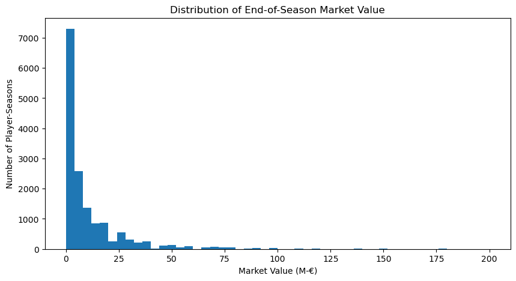

- Log-transformed target variable distribution visualization

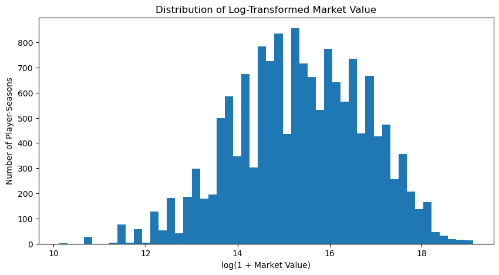

- Player age distribution

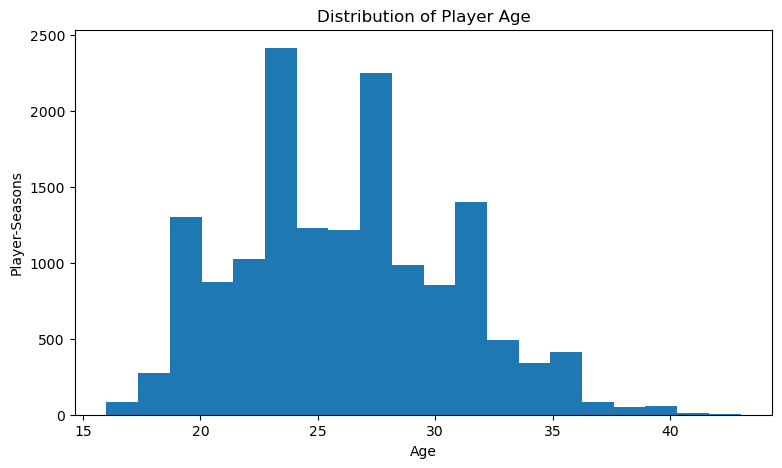

- Target variable distribution by position

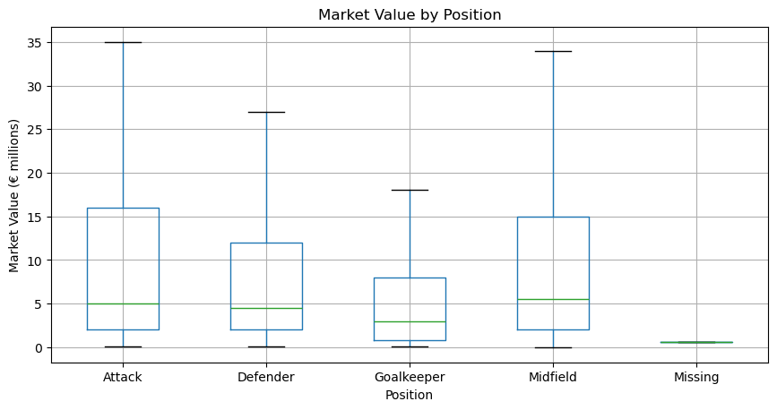

- Player height distribution

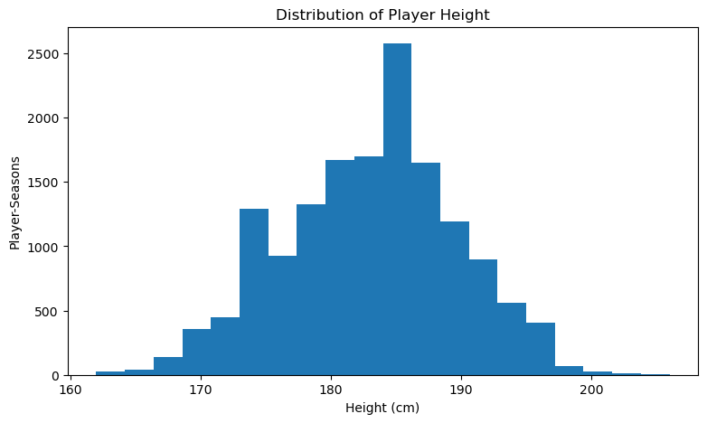

- Minutes played vs market value

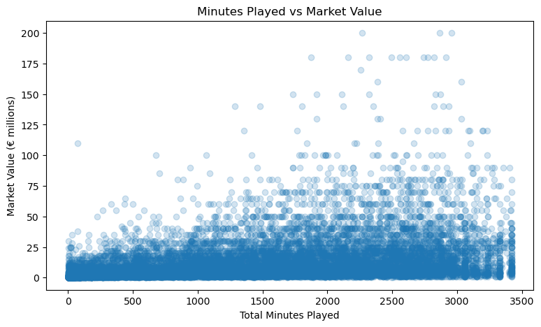

- Goals vs market value

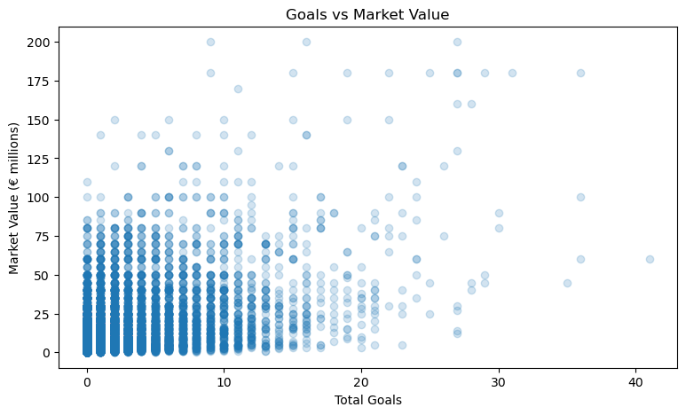

- Total clean sheets vs market value

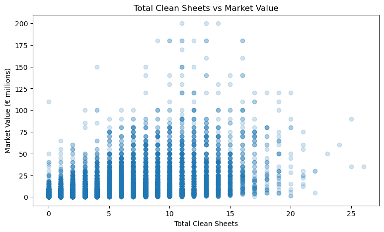

- Market value by competition

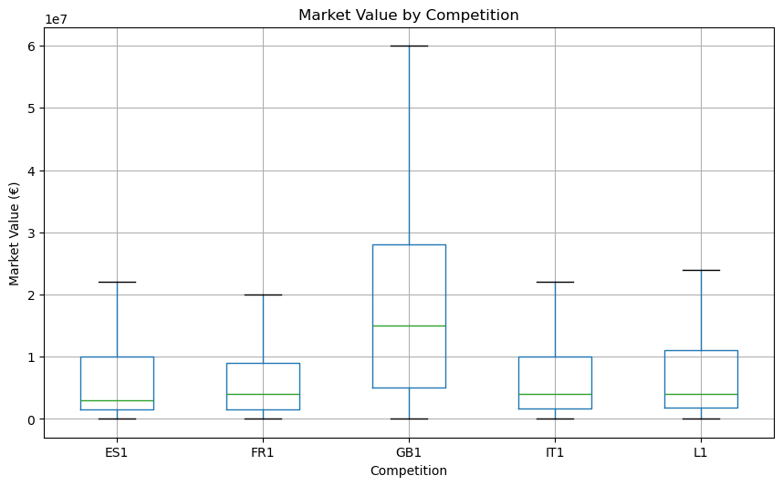

For additional EDA performed, please go to `01_eda_modeling_dataset`.

## Appendix D — Model Configuration

### Target and preprocessing

The target was the natural logarithm of market value in euros (`log_target_market_value`). Predictions were transformed back to euros using the inverse `expm1` transformation. The feature set included player profile, season performance, club context, and transfer-history variables. A separate model version included previous market valuation when available.

### Temporal training and evaluation

Model selection used expanding-window temporal validation. The validation seasons were 2021, 2022, 2023, and 2024; for each fold, the model was trained only on earlier seasons.

| Purpose | Training seasons | Validation/test season |
|---|---|---|
| Temporal validation, fold 1 | 2020 | 2021 |
| Temporal validation, fold 2 | 2020–2021 | 2022 |
| Temporal validation, fold 3 | 2020–2022 | 2023 |
| Temporal validation, fold 4 | 2020–2023 | 2024 |
| Final held-out evaluation | 2020–2024 | 2025 |

The 2025 season was held out during model selection and used for final evaluation. After that evaluation, the production models were retrained using seasons 2020–2025 for use in the application. Season numbers above follow the season labels in the modeling dataset.

### Selected XGBoost hyperparameters

| Parameter | Without previous valuation | With previous valuation |
|---|---:|---:|
| Objective | `reg:squarederror` | `reg:squarederror` |
| Number of estimators | 600 | 300 |
| Maximum tree depth | 5 | 5 |
| Learning rate | 0.05 | 0.05 |
| Subsample | 0.8 | 0.8 |
| Random state | 42 | 42 |

### Feature groups

Both model variants used the following feature groups:

- **Player and competition:** position, sub-position, preferred foot, competition, season, age, and height.
- **Season performance:** games played, minutes, goals, goals per 90, assists, assists per 90, goal contributions per 90, cards, clean sheets, and clean-sheet rate.
- **Club context:** number of clubs played for, club goals scored and conceded, club games played, and average points per game.
- **Transfer history:** previous transfer count, transfers during the season, whether the player had a previous transfer, and days since the last transfer.

The model with previous valuation additionally used the log of previous market value and the number of days since that valuation. The model without those fields was used when previous valuation information was unavailable.

### Software versions

The application was validated with Python 3.13.11. Application dependencies are recorded in `requirements.txt`; notebook, database, and test dependencies are recorded in `requirements-dev.txt`.

---

# Use of Generative AI

ChatGPT (OpenAI, 2026) was used in three parts of this project. It suggested testing a logarithmic transformation of the market-value target and using chronological validation folds. These suggestions were reviewed and evaluated during the analysis.

ChatGPT was also used extensively to develop and refine the Streamlit application's features, interface, and code. It assisted with the wording, clarity, and structure of parts of this report. The author reviewed and edited these contributions and remains responsible for the application, analysis, and final text.
